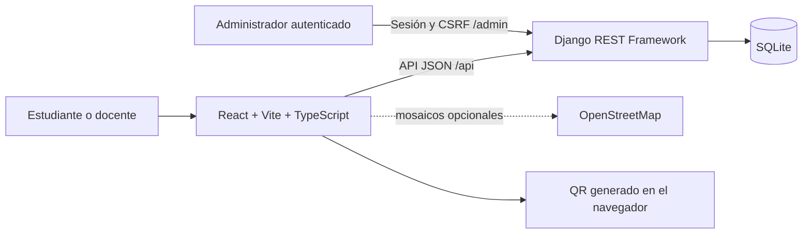
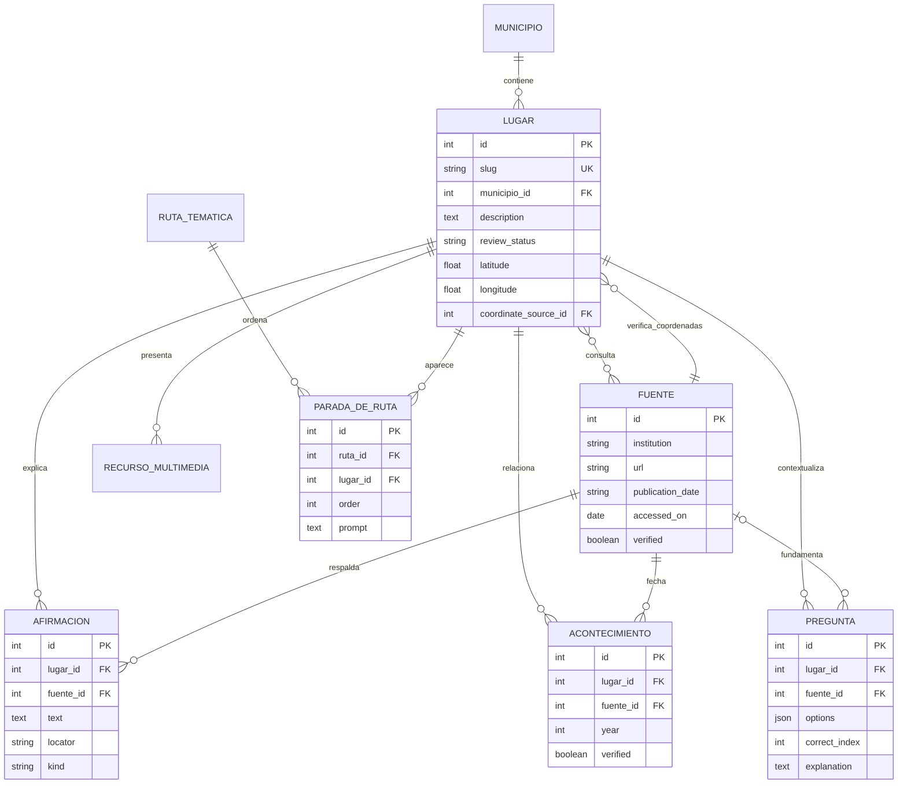
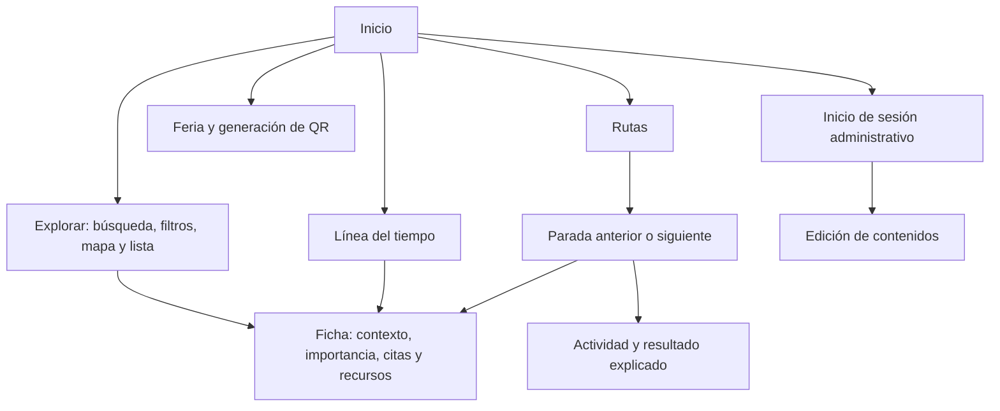

# Diagramas del sistema

## Arquitectura

En desarrollo Vite envía `/api`, `/admin` y `/static` al puerto 8000. El navegador no necesita CORS porque opera sobre el mismo origen de Vite.

## Entidad relación

La entidad Afirmación añade trazabilidad por hecho o relato. Lugar–Fuente se implementa con una tabla intermedia de Django. El par ruta/orden es único. Las coordenadas aceptan nulos; no se dibujan marcadores sin respaldo.

## Navegación y pantallas

Inicio: portada de propósito y acceso al recorrido. Explorar: filtros superiores, mapa y tarjetas equivalentes para teclado o conexión limitada. Ficha: contenido principal y panel lateral de ubicación y fuentes, apilados en móvil. Línea del tiempo: filtro por lugar, año y acceso a ficha. Ruta: indicador de progreso y una parada a la vez. Actividad: radios por pregunta y explicación final. Administración: formularios de Django, sin acceso anónimo de edición.
